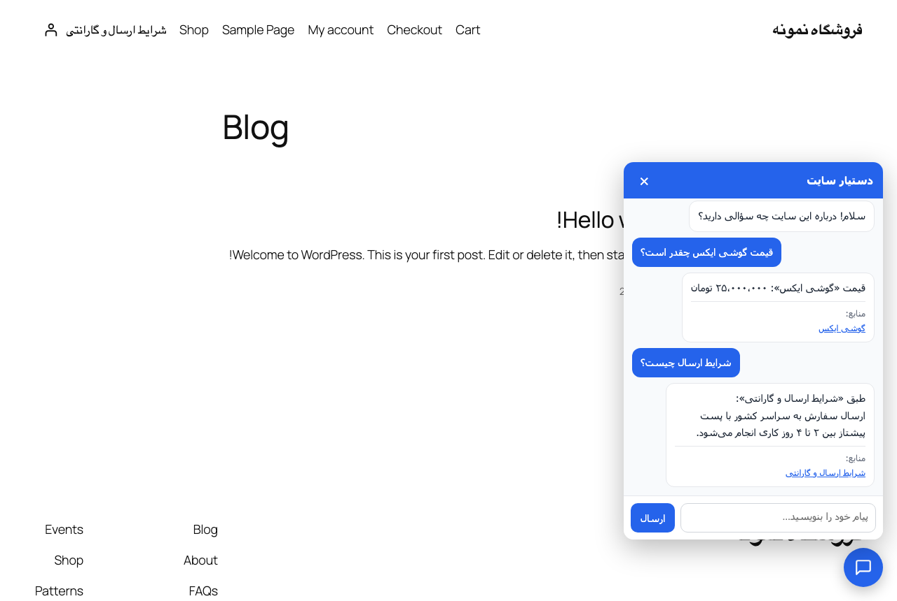
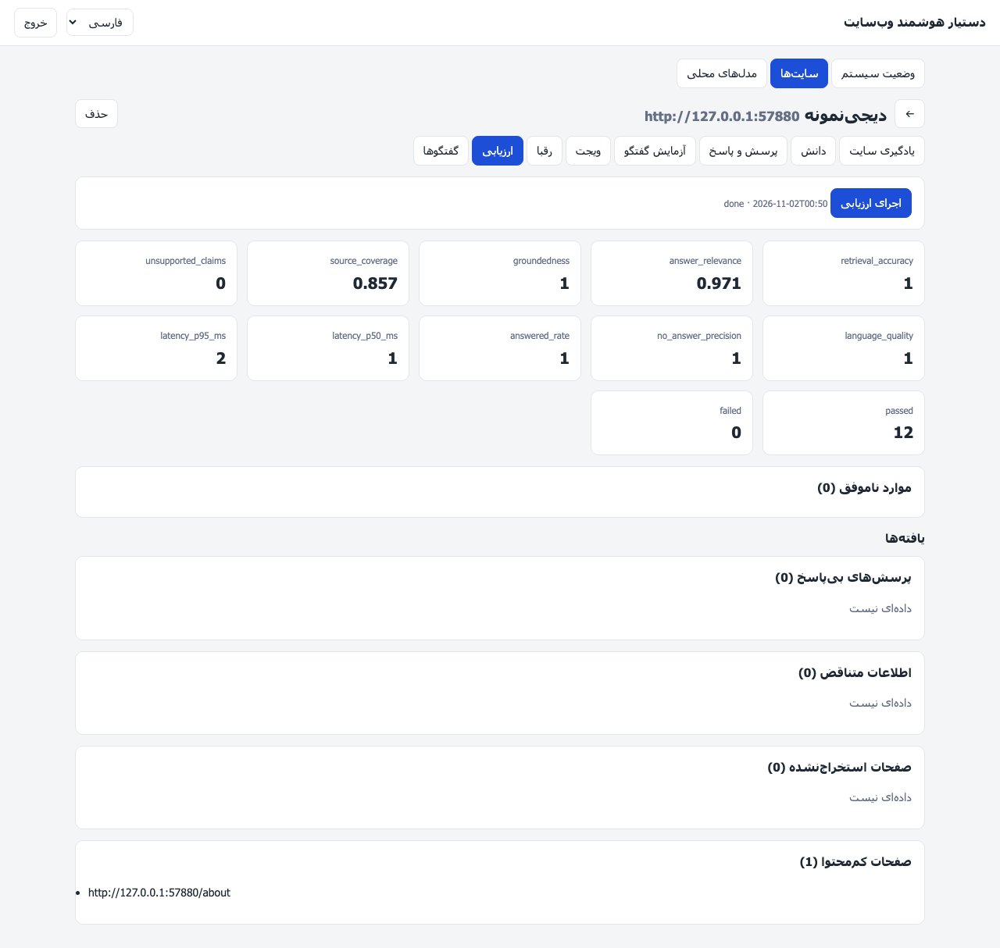

# Website Intelligence Agent

A site assistant you host yourself. It learns your website's content and answers visitors in Persian, Arabic and English, with links to its sources. When your site has no answer, it says so instead of guessing.

There is no central service. Your content and conversations stay on your own server, and no cloud AI service is required.

| Persian chat widget on WordPress | Self-evaluation in the dashboard |
|---|---|
|  |  |

> **Status: early pre-release, not yet used in production.** See [Project status](#project-status) for what has and has not been tested.

## Two editions

Choose by what your hosting can run.

| | **Lite** (WordPress plugin) | **Self-Hosted** (your VPS or server) |
|---|---|---|
| Install | Upload a ZIP in WordPress | Docker Compose or manual |
| Needs | PHP 7.4+, MySQL | Docker; 2 GB RAM, 8 GB+ with a chat model |
| Learns from | WordPress content, through its APIs | Any website, by crawling |
| Search | Words and their variants | Words and meaning (hybrid) |
| How answers are made | **Quotes your site's text. Writes no new sentences** | Local language model with source checks, or quotes if no model |
| Prices and stock | Read live from WooCommerce | Read from page data, refreshed when old |
| Competitor research | No | Yes |
| Self-evaluation | No | Yes |
| Language model | None | Ollama or llama.cpp, on your server |

Shared hosting cannot run a real language model, so Lite does not claim to. It finds the right passage and quotes it. For generated answers, run the Self-Hosted edition; a Lite site can optionally use it as its engine.

## What it does

- **Learns a site:** sitemaps, robots.txt, internal links, main-content extraction, product data, duplicate detection and language detection.
- **Stays current:** re-crawls only what changed, records price changes, and removes pages that disappear.
- **Answers with evidence:** every answer links its sources. Generated answers are checked against those sources, and a number that is not in them rejects the answer.
- **Handles three languages properly:** ی/ي, ک/ك, ۱۲۳/١٢٣/123 and half-spaces are unified, and Persian is told apart from Arabic. See [language handling](docs/languages.md).
- **Keeps competitors separate** (Self-Hosted): compares public products and topics, with source and date on every item. This data cannot reach visitors' answers.
- **Tests itself** (Self-Hosted): generates questions from your content and measures retrieval, groundedness, unsupported claims, language and latency, including whether it declines questions it should not answer.

## Quick start

**WordPress:** download `website-intelligence-agent-lite.zip`, then go to **Plugins → Add New → Upload Plugin**. [Full guide](docs/installation/wordpress.md).

**Self-Hosted:**

```bash
git clone <repository-url>
cd website-intelligence-agent
cp .env.example .env        # then set POSTGRES_PASSWORD
docker compose up -d
docker compose logs api | grep "setup token"
```

Open http://127.0.0.1:8000. [Full guide](docs/installation/self-hosted.md), including HTTPS and adding models.

## Documentation

- [Install on WordPress](docs/installation/wordpress.md), including the limits of Lite
- [Install on a server](docs/installation/self-hosted.md)
- [Choosing a local model](docs/models.md), with measured results
- [Language handling](docs/languages.md)
- [Architecture](docs/architecture/overview.md)
- [API](docs/api/README.md)
- [Troubleshooting](docs/troubleshooting/README.md)
- [Contributing](CONTRIBUTING.md) · [Security policy](SECURITY.md) · [Changelog](CHANGELOG.md)

## Project status

Tests use realistic sample sites served over real HTTP, not real customer sites.

| Area | Status |
|---|---|
| Crawling, extraction, change detection, removal (fa, ar, en sample sites) | Tested |
| SSRF protection, including redirects and DNS rebinding | Tested |
| Retrieval, follow-up questions, honest refusal | Tested on SQLite |
| Generated answers with a real local model | Tested with one model; slow on the test machine. See [results](docs/models.md) |
| Competitor reports and their separation from answers | Tested |
| Self-evaluation, including that it fails a broken assistant | Tested |
| Dashboard and widget in a real browser | Tested in Chromium |
| WordPress plugin from its ZIP, with WooCommerce, on PHP 8.2 | Tested, including a 3000-article site |
| **PostgreSQL** | **Not run yet.** Tests exist in `tests/integration/test_postgres.py` |
| **Qdrant** | **Not run yet.** Tests exist in `tests/integration/test_qdrant.py` |
| **Docker image and `docker compose up`** | **Not run yet** |
| **Semantic search with real embeddings** | **Not run yet** |
| **llama.cpp and Playwright rendering** | **Not run yet** |
| **PHP 7.4** | **Not run yet.** The code avoids PHP 8 syntax |
| **Real shared hosting** | **Not run yet** |
| Real websites at scale | Not run yet |

## License

[GPL-3.0-or-later](LICENSE). WordPress plugins must be GPL-compatible, and using one license keeps the two editions simple.
